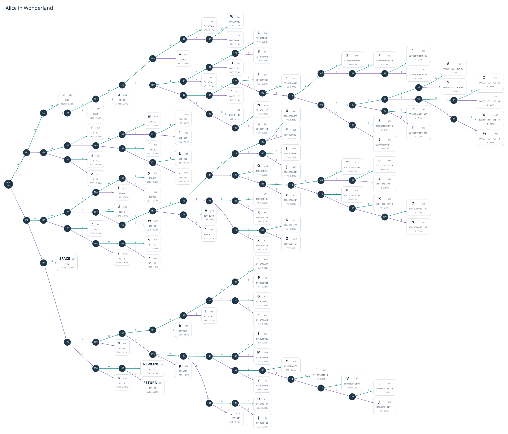

# HuffmanCoding.jl

A fixed Huffman codebook with cached bit sequences and internal node paths.
Build the tree once, then look up each object's code and path through a dictionary.

## Interface

```julia
using HuffmanCoding

weights = Dict(:a => 1, :b => 2, :c => 3)
hc = build(weights)

hc[:a]             # read-only, iterable Bool sequence
nodepath(hc, :a)   # read-only, iterable Int internal-node IDs
keys(hc)           # supported vocabulary
haskey(hc, :a)     # vocabulary membership
length(hc)         # vocabulary size

for bit in hc[:a]
    # Use each bit.
end
```

Both sequences support indexing and `length`, with one internal node per bit.
For a nonempty code, a node path includes the root and excludes the leaf: element
`i` is the node where bit `i` chooses a child. Node IDs are meaningful only within
their own codebook. Both lookups raise `KeyError` for unknown objects. The codebook
and its returned sequences expose no indexed assignment.

`build(weights)` returns a `HuffmanCode` whose default tree is an
[`AbstractTrees.StableNode`](https://juliacollections.github.io/AbstractTrees.jl/stable/#Type-Stability-and-Performance).
Internal nodes have two ordered children. The codebook's `tree::T` field remains
generic, so other tree representations can also be stored. Node IDs belong to
the codebook and do not have to be array positions.

Each default-tree node exposes an `id::Int` and an `object` through
`AbstractTrees.nodevalue(node)`. Leaves store the vocabulary objects they encode;
internal nodes have `object = nothing`. A node is a leaf when it has no children,
so `nothing` can also be a legitimate vocabulary object. Each vocabulary object
labels exactly one leaf.

Following bits from the root (`false` selects the first child, `true` the second)
ends at the leaf containing the encoded object. For example, the test fixture's
code `10` reaches node 4, then leaf 1 with `(id = 1, object = :a)`. This makes the
tree interpretable without a separate leaf-to-object dictionary or the original
weights. `nodepath(hc, :a)` is `[5, 4]`: bit `1` is chosen at root 5, then bit `0`
at internal node 4. The sibling `:b` has code `11` and the same node path `[5, 4]`;
the final bit selects a different leaf. For `:c`, code `0` has node path `[5]`.

`HuffmanCode` holds only the tree and an internal dictionary whose entries contain
both bits and node paths. The dictionary keys supply the vocabulary. Weights are
input to `build` and are not retained. Changing, adding, or deleting entries in
the original weight mapping will leave the built tree and codebook unchanged.
Vocabulary objects themselves are not deep-copied.

The weight mapping must be nonempty and contain finite, nonnegative real weights.
A single-object vocabulary has an empty code and node path. Equal weights may
produce different, equally optimal codes; branch orientation and node numbering
are not guaranteed across builds. Whole-message encoding and decoding are not
implemented.

## Visualizing a tree

The Gutenberg example renders a labeled tree as a scalable SVG. Leaves show
characters, bit codes, and frequencies; internal nodes show their IDs. Spaces
and newlines have readable labels.

With [Graphviz](https://graphviz.org/) installed (`brew install graphviz` on macOS):

```sh
julia --project=example -e 'using Pkg; Pkg.instantiate()'
julia --project=example example/EncodingGutenberg.jl
```

The SVG is saved to `example/output/huffman-tree.svg`.
You can also visualize an existing codebook from Julia:

```julia
include("example/PlotTree.jl")
svg_path = plot_tree(hc.tree)  # optionally pass weights=weights
```

[](viz/huffman-tree.svg)

## Running the tests

The test layout follows
[RxInfer.jl](https://github.com/ReactiveBayes/RxInfer.jl/blob/main/test/runtests.jl):
isolated `@testitem` blocks, verbose `TestItemRunner` discovery, optional Aqua
checks, and filename filters.

```sh
julia --project -e 'using Pkg; Pkg.test()'
```

Run only node-path tests, using a colon-separated path filter:

```sh
julia --project -e 'using Pkg; Pkg.test(test_args=["interface:nodepath_tests.jl"])'
```

Disable Aqua checks for an interface-only run:

```sh
RUN_AQUA=false julia --project -e 'using Pkg; Pkg.test()'
```

The suite checks construction, code and node-path lookup, vocabulary queries,
read-only sequences, independence from input changes, and package quality with Aqua.
